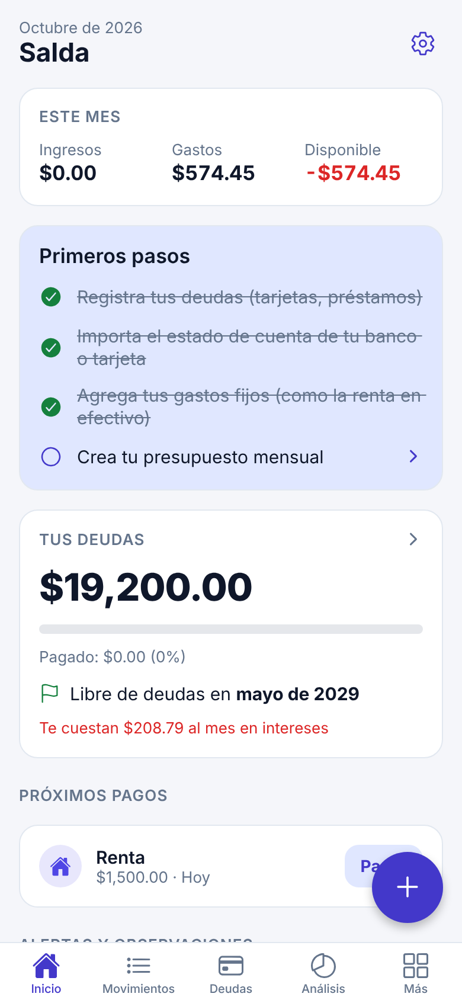
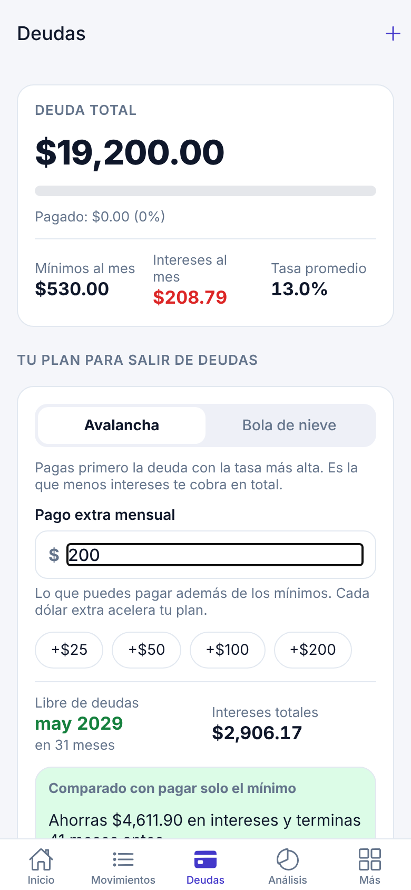
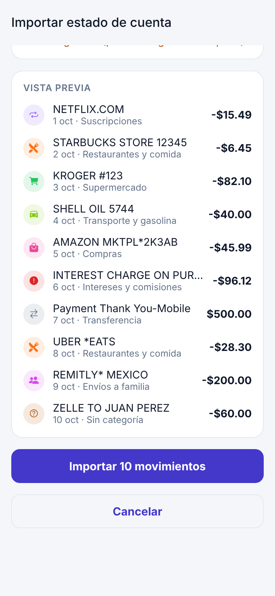
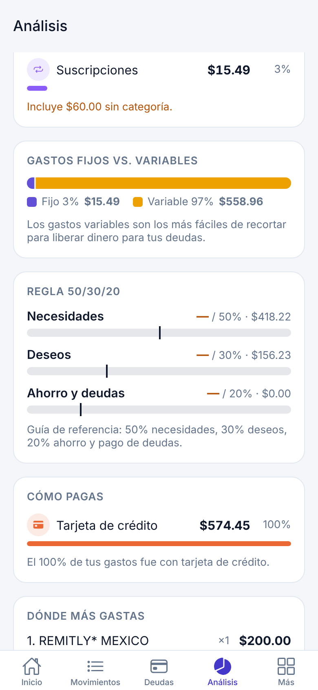
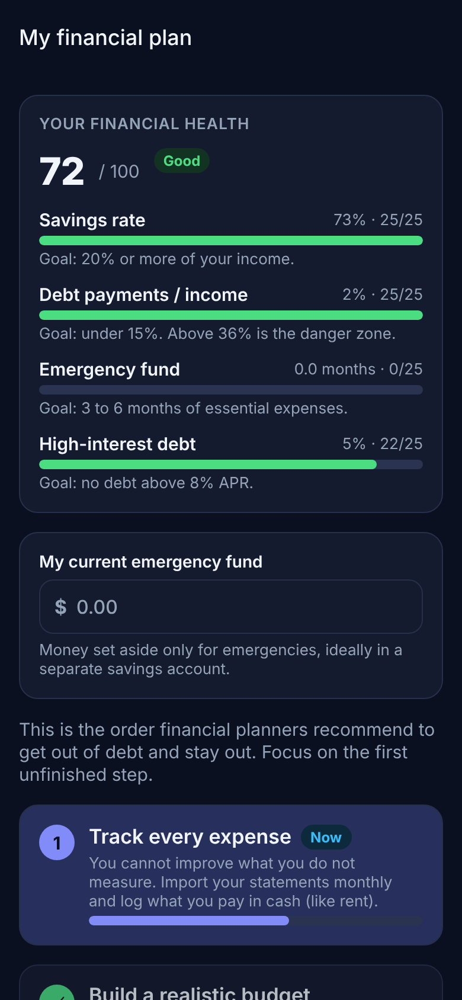

# Salda: deudas, gastos y presupuesto

App móvil (iOS y Android) de finanzas personales, **bilingüe (español/inglés)** y **privada**: todo se guarda en el teléfono. Está pensada para salir de deudas, entender los gastos (fijos vs. variables) y seguir un plan financiero paso a paso.

> 📘 **Tu plan financiero personal:** [`docs/PLAN_FINANCIERO.md`](docs/PLAN_FINANCIERO.md)
> 🚀 **Cómo publicarla y venderla:** [`docs/LANZAMIENTO.md`](docs/LANZAMIENTO.md)
> 🔒 **Política de privacidad (plantilla):** [`docs/PRIVACY_POLICY.md`](docs/PRIVACY_POLICY.md)

<p>
  
  
  
  
  
</p>

## Funciones

| Área | Qué hace |
|---|---|
| **Deudas** | Tarjetas, préstamos, BNPL, deuda médica… Plan **avalancha** o **bola de nieve** con pago extra, fecha en que quedas libre de deudas, intereses totales, comparación contra pagar solo mínimos, "¿cuánto necesito para salir en N meses?", gráfica de saldo, alerta cuando el mínimo no cubre los intereses, uso del límite de crédito, registro de pagos y actualización de saldo. |
| **Importar CSV** | Detecta automáticamente las columnas de Chase, Bank of America, Wells Fargo (sin encabezado), Capital One (cargos/abonos), Amex, Discover, Citi y bancos en español; formatos de fecha MDY/DMY/ISO y signos de monto. Evita duplicados al reimportar. |
| **Auto-categorización** | Diccionario de comercios comunes en EE. UU. (supermercados, gasolineras, apps de comida, remesas, servicios, suscripciones…), detección de intereses y comisiones, y de pagos de tarjeta como transferencias (para no contar el gasto dos veces). **Aprende** cuando corriges una categoría. |
| **Movimientos** | Gastos, ingresos y transferencias; forma de pago (tarjeta de crédito/débito, transferencia, Zelle/PayPal, **efectivo**, cheque); búsqueda y filtros. |
| **Gastos fijos** | Renta (aunque sea en efectivo), servicios, seguros, nómina; próximos vencimientos, "Pagado" en un toque y **detección de suscripciones** en tu historial. |
| **Presupuestos** | Límite mensual por categoría, sugerencia automática con tus últimos 3 meses, ingreso sin asignar. |
| **Análisis** | Flujo de efectivo, tasa de ahorro, tendencia de 6 meses, gastos por categoría, **fijos vs. variables**, regla **50/30/20**, cómo pagas, dónde más gastas e intereses pagados en 12 meses. |
| **Mi plan** | Orden de prioridades de un planificador financiero (registrar → presupuesto → fondo inicial → no más deuda → deuda cara → fondo completo → retiro), puntaje de salud financiera de 0 a 100 y estrategias (negociar APR, transferencia de saldo, consolidación, asesoría sin fines de lucro). |
| **Recordatorios** | Notificaciones locales antes de que venzan tus gastos fijos y el pago de cada deuda (mismo día, 1, 3 o 7 días antes, a la hora que elijas). Se reprograman solas cuando cambian tus datos. |
| **Seguridad** | Bloqueo con Face ID, huella o código del teléfono; oculta tus datos en el selector de apps. |
| **Respaldo** | Archivo de respaldo con todos tus datos para cambiar de teléfono o recuperarlos; la restauración valida y limpia el archivo antes de reemplazar nada. Aviso en Inicio si llevas más de 30 días sin respaldar. |
| **General** | Español/inglés, modo oscuro, varias monedas, exportación CSV, borrar todos los datos y aviso legal. |

## Tecnología

- **Expo SDK 57** + React Native 0.86 + **Expo Router** (rutas por archivos en `src/app`)
- **expo-sqlite** (base de datos local con migraciones) + **zustand** (estado)
- **react-native-svg** para gráficas propias (colores validados para daltonismo)
- **TypeScript** estricto, **Vitest** para la lógica financiera y **ESLint** (`eslint-config-expo`)

```
src/
  core/        Lógica financiera pura y probada (sin React)
    debt.ts         Simulación de pago de deudas, estrategias y metas
    csv.ts          Lector de CSV, detección de columnas, fechas y montos
    categorize.ts   Auto-categorización y reglas aprendidas
    analytics.ts    Resumen mensual, 50/30/20, presupuestos, tendencias
    recurring.ts    Gastos fijos, frecuencias y detección de suscripciones
    health.ts       Puntaje de salud financiera
    plan.ts         Pasos del plan financiero
    insights.ts     Alertas en lenguaje simple
    reminders.ts    Qué recordatorios programar y cuándo
    backup.ts       Formato del respaldo, validación y limpieza al restaurar
  data/        SQLite: esquema, migraciones, repositorio y exportación
  state/       Store (zustand) y selectores derivados
  i18n/        Diccionarios es/en y formato de moneda y fechas
  ui/          Componentes, gráficas y selectores
  app/         Pantallas (Expo Router)
docs/          Plan financiero, guía de lanzamiento y privacidad
```

## Cómo correrla

```bash
npm install
npx expo start          # escanea el QR con un development build, o usa "a" o "i" para un emulador
```

> Algunas librerías nativas (datetimepicker, sqlite) requieren una **development build** si Expo Go no las incluye en su versión: `npx expo run:android` / `npx expo run:ios`, o `npx eas-cli build --profile preview` (ver `docs/LANZAMIENTO.md`).

También corre en navegador (`npx expo start --web`); `metro.config.js` agrega los encabezados que necesita SQLite en web.

## Verificación

```bash
npm test            # pruebas de la lógica financiera (Vitest)
npm run typecheck   # TypeScript
npm run lint        # ESLint
npm run check       # las tres juntas
```

## Aviso

Salda es una herramienta educativa. Los cálculos son estimaciones basadas en los datos que ingresas (interés mensual = APR/12) y pueden diferir de los de tu banco. No constituye asesoría financiera, fiscal ni legal.
